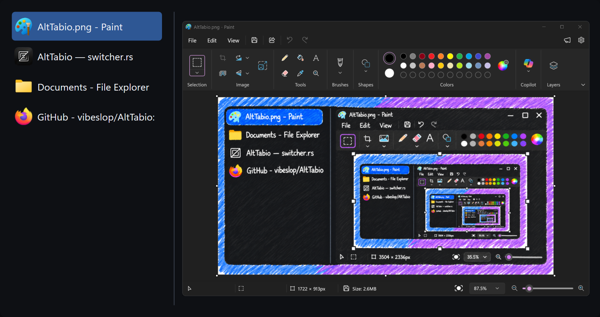

# AltTabio

A free, open-source window switcher. It replaces Alt+Tab on 64-bit Windows 10 and 11 and Cmd+Tab on macOS 26 and later.

[Website](https://vibeslop.github.io/AltTabio/) · [Download](https://github.com/vibeslop/AltTabio/releases/latest)



[More screenshots](docs/screenshots.md): scrolling, search, expanded rows, and light and dark themes.

On Windows, search open windows as you type and see a live preview of the selection. On macOS, browse each app's windows, including minimized windows, hidden apps, and other Spaces.

## Install

### Windows

1. Download the Windows archive and its matching `.zip.minisig` from the same [GitHub release](https://github.com/vibeslop/AltTabio/releases/latest).
2. Follow [Windows first-install verification](docs/windows-install.md) to authenticate the archive and signed release identity with the existing AltTabio public key. Build the verifier from separately trusted source, never from the downloaded archive. Stop if verification fails or the signature is missing.
3. After verification succeeds, extract that archive to a folder that only administrators can change, such as `C:\Program Files\AltTabio`.
4. Run `AltTabio.exe` and accept the administrator prompt.

AltTabio needs administrator rights. **Start at sign-in** runs it with those rights at each logon. Both this setting and the updater require a folder that non-elevated processes cannot modify.

Release builds download verified updates automatically and restart after five idle minutes with the switcher and dialogs closed, preserving settings. Turn off automatic updates in Settings to check manually. In the tray, choose **Check for Updates** or **Update status**, then **Install and restart** or **Restart now** in the status window. See [update behavior, trust, and upgrade notes](docs/windows-updater.md).

To uninstall, turn off **Start at sign-in** if enabled, choose **Exit** from the tray menu, and delete the folder.

### macOS

Expand the command below to install or update AltTabio.

<details>
<summary>Verified macOS installer command</summary>

Copy this whole block into Terminal. It downloads the newest published macOS installer image and verifies it against AltTabio's pinned release certificate **before mounting it or running its script**. No script from GitHub Pages is executed.

```sh
/bin/sh <<'ALTTABIO_BOOTSTRAP'
set -eu

work=$(mktemp -d)
mounted=false
trap 'if ! $mounted || hdiutil detach "$work/mount" -quiet; then rm -rf "$work"; fi' EXIT
trap 'exit 1' HUP INT TERM
# Bound actual file writes even when Content-Length is absent or an older curl only
# checks advertised sizes. ulimit -f blocks can be 512 or 1024 bytes; use the larger unit.
fetch() (
    ulimit -c 0
    ulimit -f "$(($3 / 1024))"
    curl --fail --location --silent --show-error --proto '=https' --proto-redir '=https' \
        --connect-timeout 15 --max-time "$4" --max-filesize "$3" --output "$2" -- "$1"
    [ "$(wc -c < "$2")" -le "$3" ]
)
fetch 'https://api.github.com/repos/vibeslop/AltTabio/releases?per_page=30' "$work/releases.json" 4194304 30
url=$(osascript -l JavaScript -e 'function run() {
        ObjC.import("Foundation");
        const data = $.NSFileHandle.fileHandleWithStandardInput.readDataToEndOfFile;
        const releases = JSON.parse($.NSString.alloc.initWithDataEncoding(data, $.NSUTF8StringEncoding).js);
        for (const release of releases) {
            if (release.draft || release.prerelease) continue;
            const asset = release.assets.find(a => a.name === "AltTabio-macos-installer.dmg");
            if (asset) return asset.browser_download_url;
        }
        return "";
    }' < "$work/releases.json")
[ -n "$url" ] || { echo 'No signed macOS installer is published yet.' >&2; exit 1; }
fetch "$url" "$work/installer.dmg" 33554432 180
codesign --verify --strict -R '=identifier "com.vibeslop.AltTabio.installer" and certificate leaf = H"617A82407E9767025EDE4A62A9B990ADEA21F53B"' "$work/installer.dmg"
mkdir "$work/mount"
hdiutil attach "$work/installer.dmg" -readonly -nobrowse -mountpoint "$work/mount" -quiet
mounted=true
/bin/sh "$work/mount/install.sh"
ALTTABIO_BOOTSTRAP
```

The bootstrap and its certificate pin must come from a copy of this README you trust. They match [the local bootstrap](scripts/mac/bootstrap.sh) and [the existing release-certificate pin](scripts/mac/release-certificate.sha1). Release metadata and download hosting can choose an image, but cannot authorize a modified installer without that signing key. The protected macOS release job signs the image with the same certificate used for the app. This authenticates release authorization, not freshness; it cannot prevent replay of an older signed installer. Until a release includes the signed image, the command stops without running an installer.

</details>

The script updates an existing installation in place, preferring `/Applications` over `~/Applications` if both exist. For a new installation, it uses `/Applications` if writable, otherwise `~/Applications`, then starts AltTabio in the menu bar. An existing copy in `/Applications` still requires permission to replace it.

Allow Accessibility when prompted. Screen Recording is optional and used only for previews; the window list and switching work without it. See [permissions](https://vibeslop.github.io/AltTabio/mac/#permissions).

Updates are automatic. Turn off **Update automatically** in Settings to opt out; **Check for Updates** in the menu bar still works.

AltTabio is not notarized, so macOS blocks a copy downloaded in a browser. The [Mac page](https://vibeslop.github.io/AltTabio/mac/#install) covers verified manual installation and removal.

## Essential controls

### Windows

By default, releasing Alt switches to the selected window. Starting a search keeps the switcher open after release; press Enter or click a result to switch.

| Input | Action |
| --- | --- |
| Alt+Tab or Win+Tab | Open the switcher and move through it |
| Up, Down, Tab, or Shift+Tab | Change the selected window |
| Mouse wheel | Scroll over the list; elsewhere, select the previous or next window |
| Enter or click | Switch to the selected window |
| 1-9 | Switch to that row when the query is empty; otherwise type the digit. Number labels are off by default. |
| Type | Filter by window title, app name, or number |
| Escape or click outside | Close the switcher |

### macOS

| Input | Action |
| --- | --- |
| Cmd+Tab | Open the switcher on the previous app; Tab and Shift+Tab step through the apps |
| Left, Right, or ` (backtick) | Previous or next app |
| Up, Down | The selected app's windows |
| 1-9 | Switch to that window of the selected app |
| Release Cmd, Return, or click | Switch to the selected window |
| W, M, H, or Q while holding Cmd | Close or minimize the window, or hide or quit the app |
| Right-click | More commands, including Force Quit |
| Escape or click outside | Close the switcher without switching |

Settings open from the tray icon on Windows and from the menu bar icon on macOS. The website lists every shortcut and setting for [Windows](https://vibeslop.github.io/AltTabio/windows/#shortcuts) and [macOS](https://vibeslop.github.io/AltTabio/mac/#shortcuts).

The interface supports English, Russian, and Simplified Chinese. Choose a language in Settings, or leave **System** selected to use the first supported language in your system's preferred languages, with English as the fallback. On Windows, language changes preview immediately and are kept with **Save changes**; **Cancel** restores the previous language. macOS settings apply immediately.

## Building

[CONTRIBUTING.md](CONTRIBUTING.md#building) covers prerequisites, build commands, required checks, debug flags, and releasing.

## License

AltTabio is licensed under the [MIT License](LICENSE). Third-party components and their licenses are listed in [THIRD_PARTY_LICENSES.md](THIRD_PARTY_LICENSES.md).
