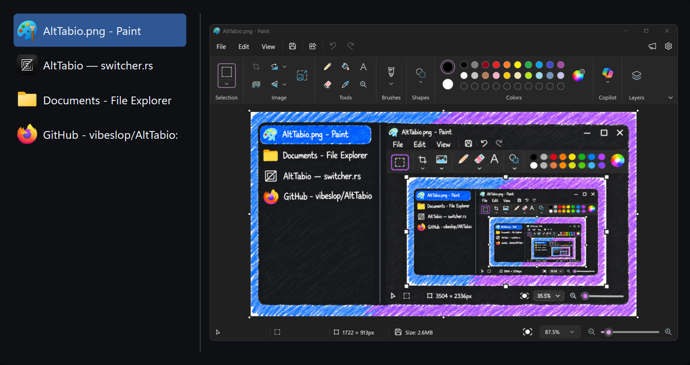

# AltTabio

A free, open-source window switcher for Windows and Mac. It replaces Alt+Tab on Windows 10 and 11 (64-bit) and Cmd+Tab on macOS 26 and later, keeping the shortcut you already know and adding a window list, previews, and 1–9 shortcuts.

[Website](https://vibeslop.github.io/AltTabio/) · [Docs](https://vibeslop.github.io/AltTabio/docs/) · [Download](https://github.com/vibeslop/AltTabio/releases/latest)



[More Windows screenshots](docs/screenshots.md)

- **Windows:** A window list beside a live preview, type-to-search, 1–9 shortcuts, and quick close, minimize, maximize, or end-program actions. Replaces Alt+Tab (and optionally Win+Tab).
- **Mac:** Your running apps along the top and every window of the selected app below, including minimized windows, hidden apps, and windows on other desktops, with 1–9 shortcuts and optional previews. Replaces Cmd+Tab (and optionally Option+Tab).
- **Free and private:** No ads, no account, and no tracking. AltTabio only goes online to check for updates, and you can turn that off in Settings.

## Install

### Windows

Press **Start**, type **PowerShell**, open it, paste this line, and press **Enter**:

```powershell
irm https://vibeslop.github.io/AltTabio/install.ps1 | iex
```

[The script](docs/install.ps1) downloads the latest version, verifies AltTabio's signature, installs it in `C:\Program Files\AltTabio`, and opens it. Choose **Yes** when Windows asks for permission so AltTabio can replace Alt+Tab and close frozen apps.

Prefer not to use PowerShell? See [install and verify by hand](docs/windows-install.md).

### macOS

Press **Cmd+Space**, type **Terminal**, press **Return**, paste this line, and press **Return**:

```sh
curl -fsSL https://vibeslop.github.io/AltTabio/install.sh | sh
```

[The script](docs/install.sh) downloads the latest version, verifies AltTabio's [release certificate](scripts/mac/release-certificate.sha1), installs it in Applications, and opens it. Allow **Accessibility** when asked so AltTabio can replace Cmd+Tab. **Screen Recording** is optional and only used for window previews.

Prefer not to use Terminal? See [install by hand](https://vibeslop.github.io/AltTabio/docs/#manual-mac).

## Controls

### Windows

Letting go of Alt switches to the selected window. If you start typing to search, the switcher stays open until you press Enter or click a result.

| Input | Action |
| --- | --- |
| Alt+Tab or Win+Tab | Open and step through windows |
| Up, Down, Tab, Shift+Tab | Move selection |
| Mouse wheel | Scroll over the list, or step through windows elsewhere |
| Type | Filter by title, app name, or number |
| 1–9 | Jump to that row (when not searching; number labels are off by default) |
| Enter or click | Switch to the selected window |
| F4–F9 or right-click | Close, minimize, maximize, restore, end program, or open another window |
| Escape or click outside | Close without switching |

### macOS

| Input | Action |
| --- | --- |
| Cmd+Tab | Open on the previous app; Tab and Shift+Tab step through apps |
| Left, Right, or `` ` `` | Previous or next app |
| Up, Down | Step through the selected app's windows |
| 1–9 | Jump to that window of the selected app |
| Release Cmd, Return, or click | Switch to the selected window |
| W, M, H, or Q (holding Cmd) | Close or minimize window, hide or quit app |
| Right-click | More actions, including Force Quit |
| Escape or click outside | Close without switching |

## Settings, updates, and uninstall

Open **Settings** from the tray icon on Windows or the menu bar icon on Mac. AltTabio is available in English, Russian, and Simplified Chinese. See the [Docs](https://vibeslop.github.io/AltTabio/docs/) for every shortcut, setting, and permission detail.

AltTabio checks for updates daily and updates itself while your computer is idle, keeping your settings. You can turn off automatic updates in Settings and check manually from the tray or menu bar icon. For technical details on Windows updates, see [docs/windows-updater.md](docs/windows-updater.md).

To uninstall on Windows, turn off **Start at sign-in** if enabled, exit from the tray icon, and delete `C:\Program Files\AltTabio`. On a Mac, turn off **Launch at login**, quit from the menu bar icon, delete `AltTabio.app`, and follow the [Docs](https://vibeslop.github.io/AltTabio/docs/#uninstall) to clear its settings and permissions.

## Building and license

For building from source and contributing, see [CONTRIBUTING.md](CONTRIBUTING.md#building) and [AGENTS.md](AGENTS.md).

AltTabio is licensed under the [MIT License](LICENSE). Third-party licenses are listed in [THIRD_PARTY_LICENSES.md](THIRD_PARTY_LICENSES.md).
