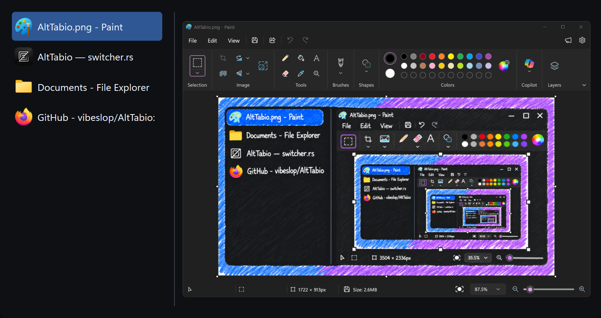
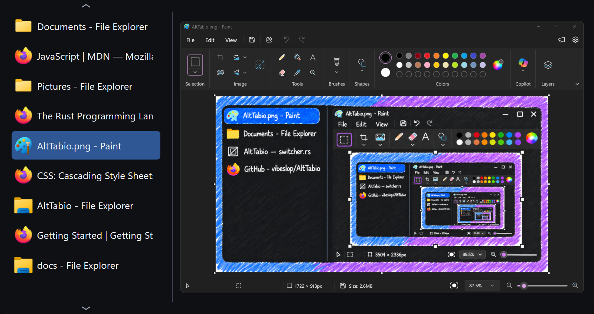
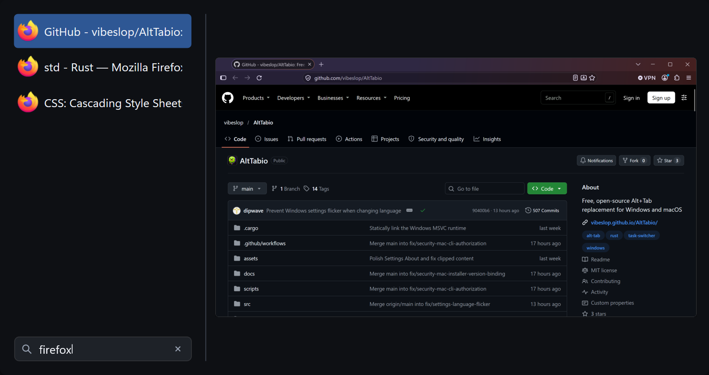
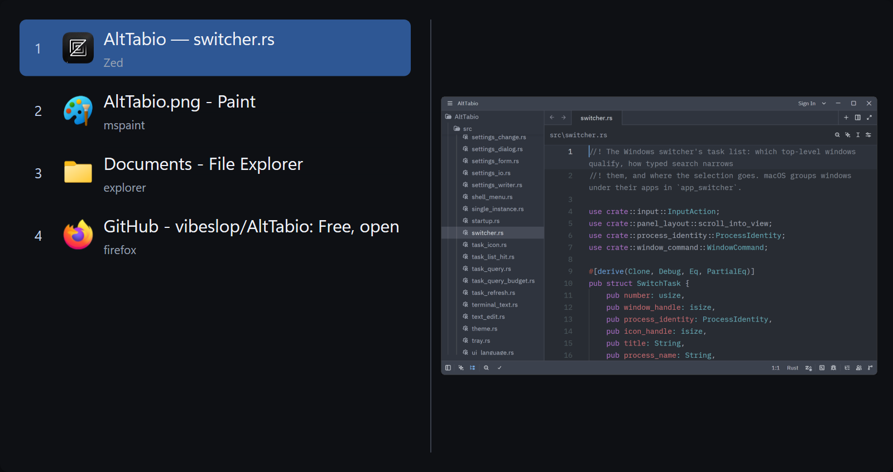
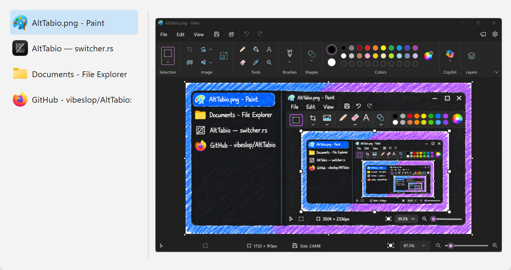
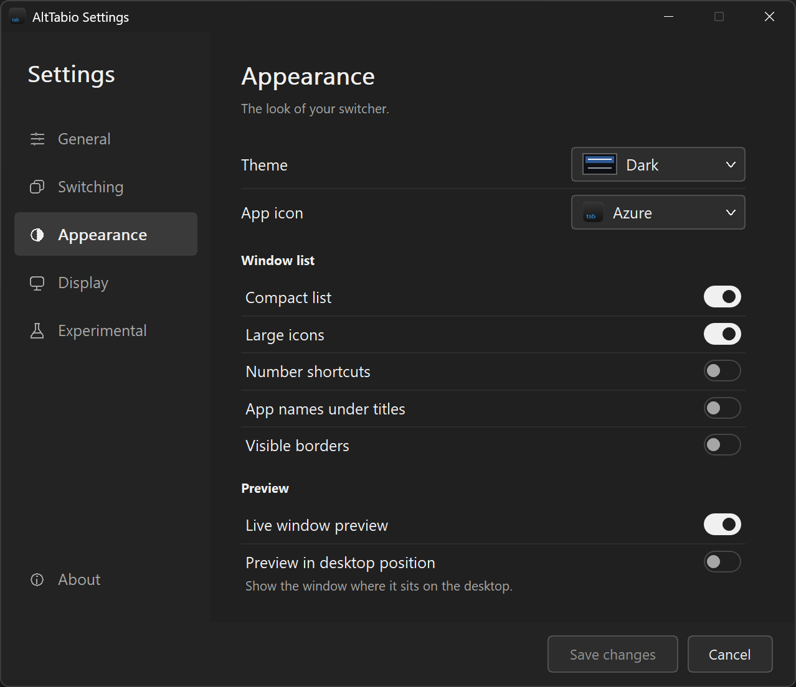
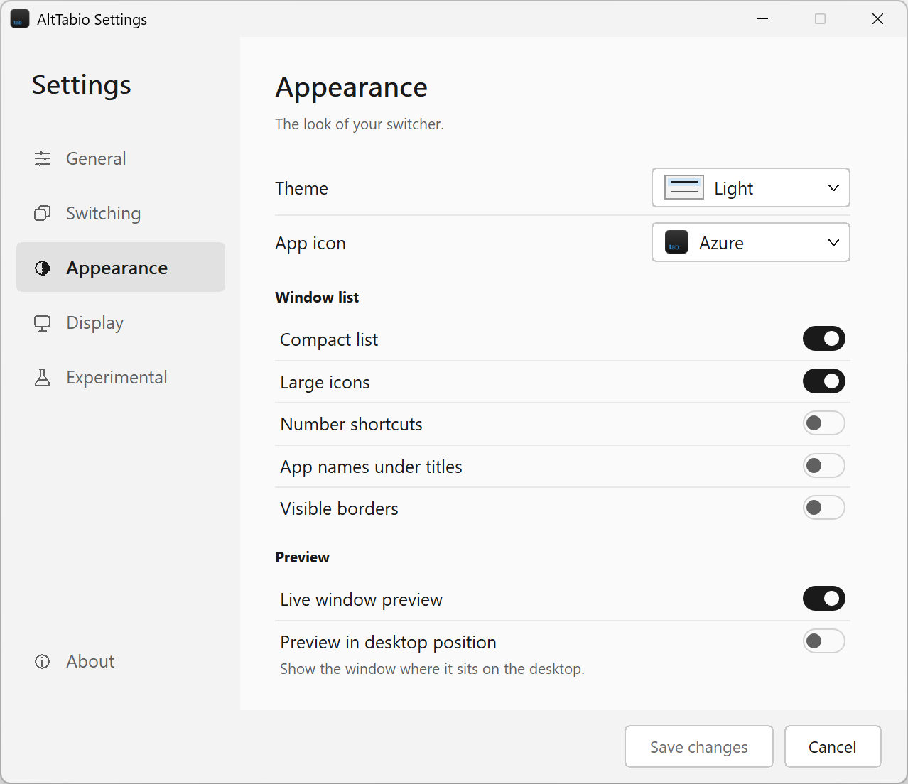

# Windows screenshots

## Compact window list

Paint, Zed, File Explorer, and Firefox, with a live preview of the selected Paint window.

## Scrolling

The compact list with more windows. Both arrows are visible because there are windows above and below the current view.

## Search

Typing `firefox` narrows the list to three Firefox windows.

## Expanded rows

Larger rows with optional number labels and app names, showing AltTabio's source in Zed.

## Light theme

The same compact layout and Paint preview in the light theme.

## Appearance settings

Theme, icon, window-list, and preview settings in dark and light themes.

